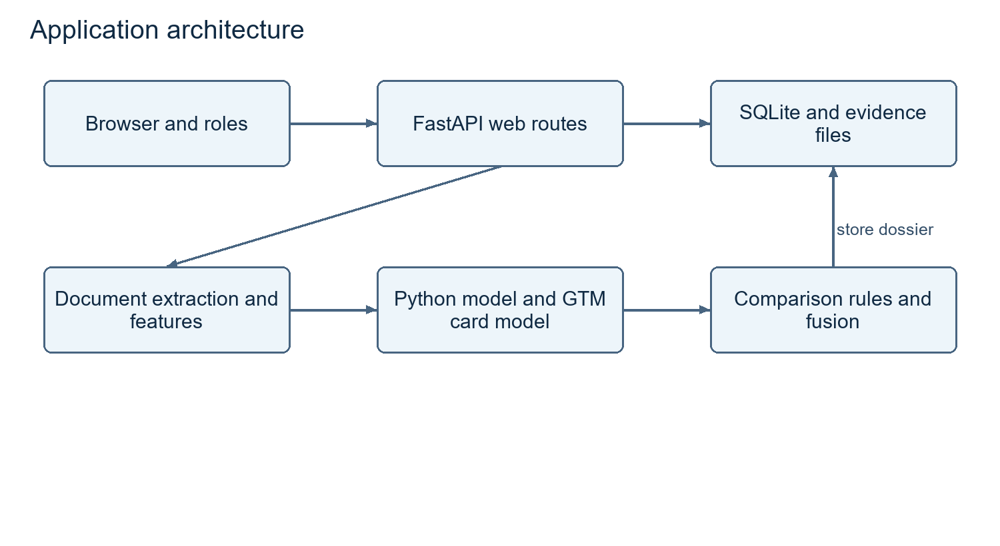
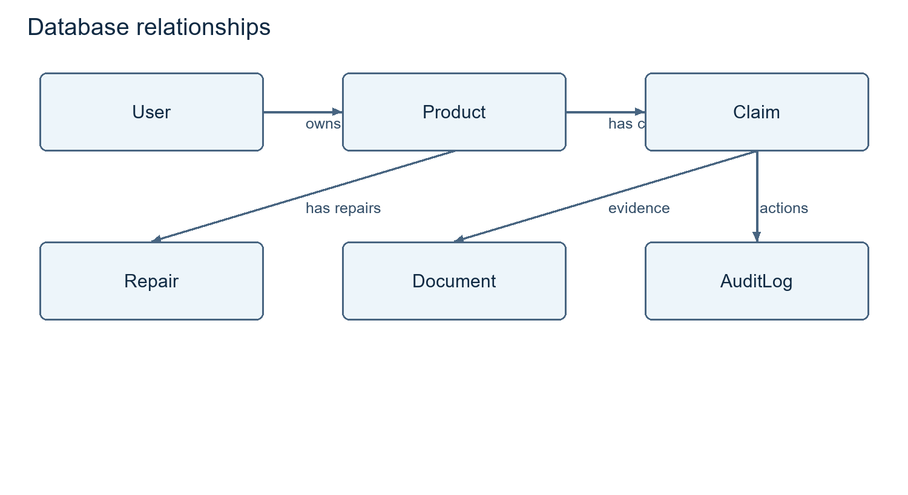
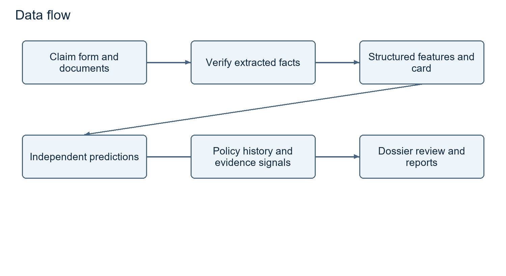
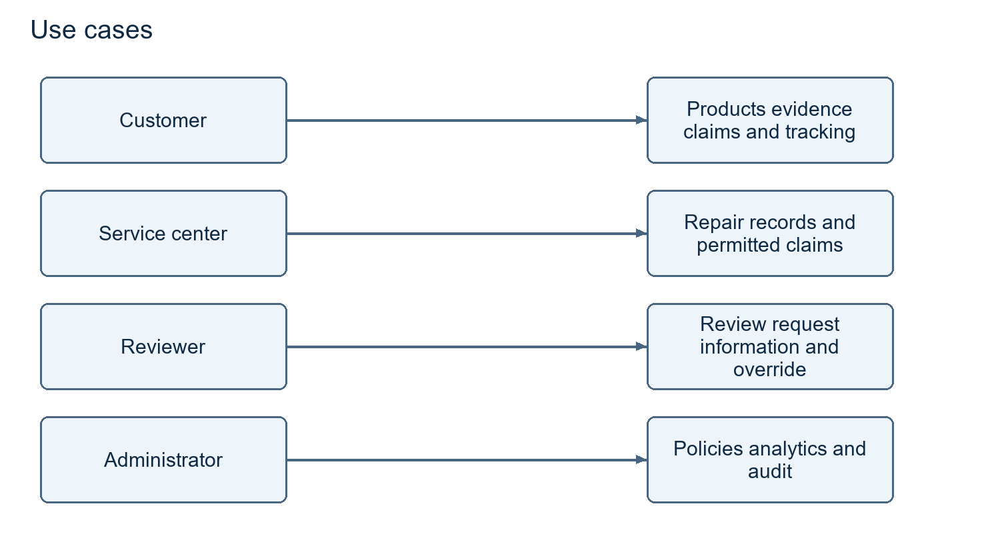
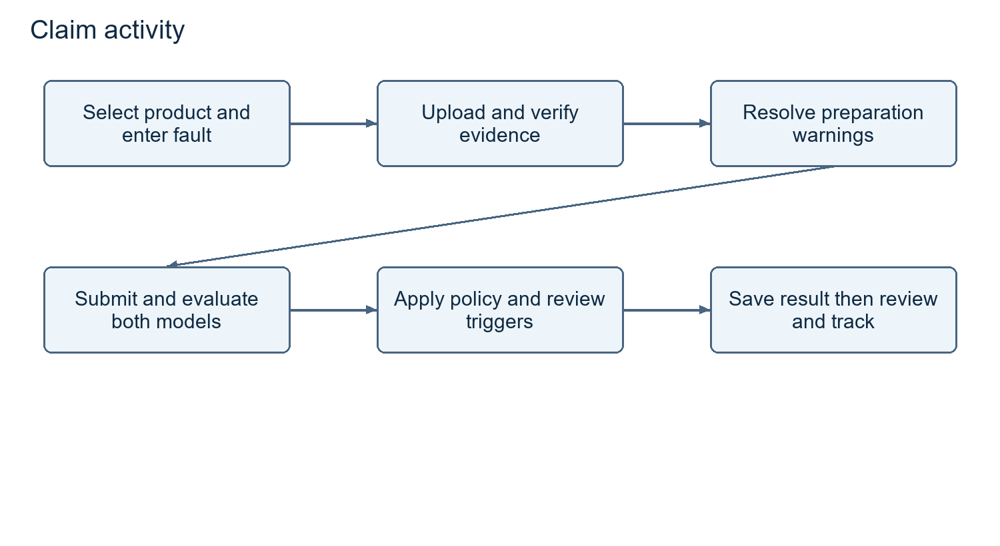
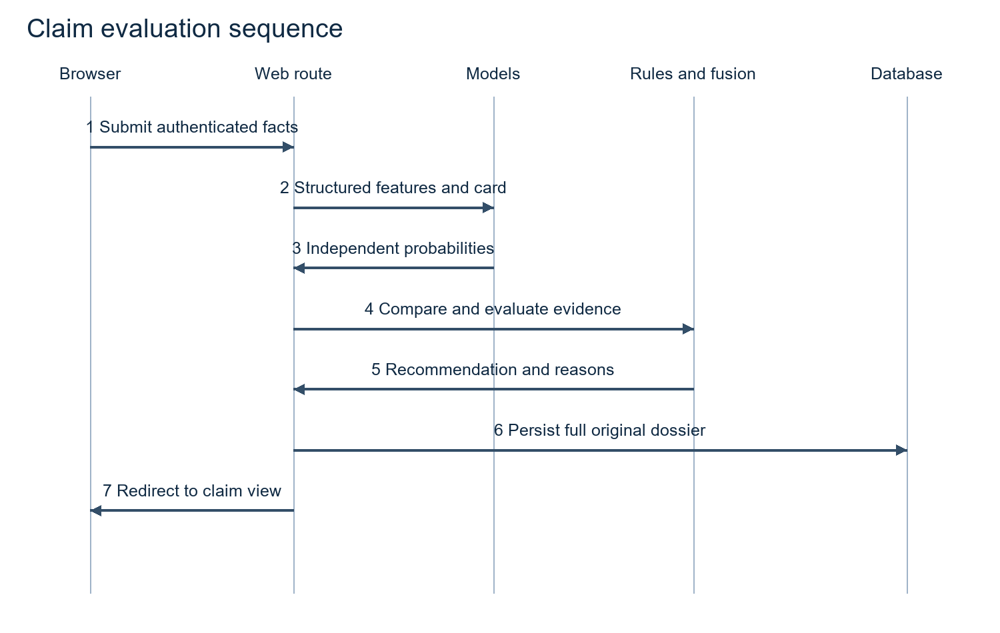
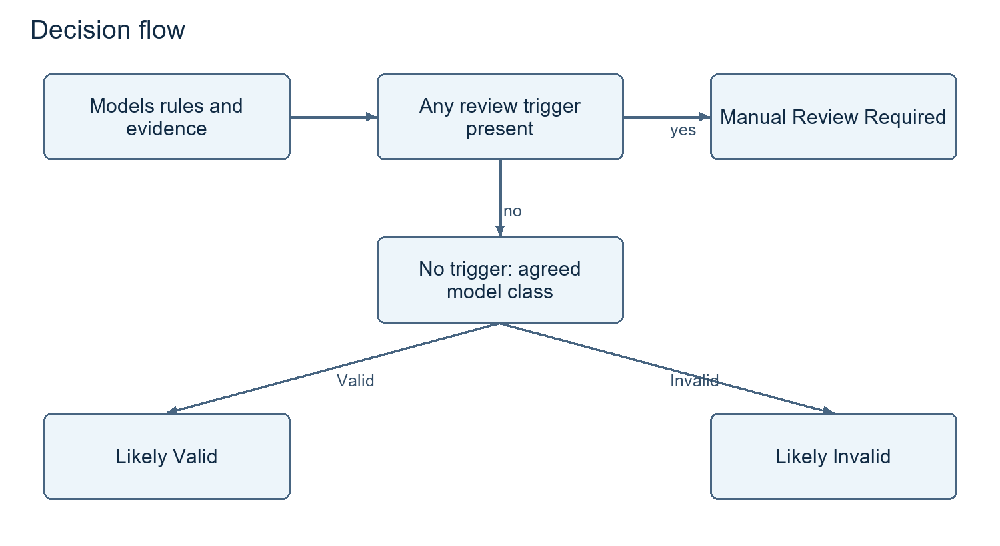
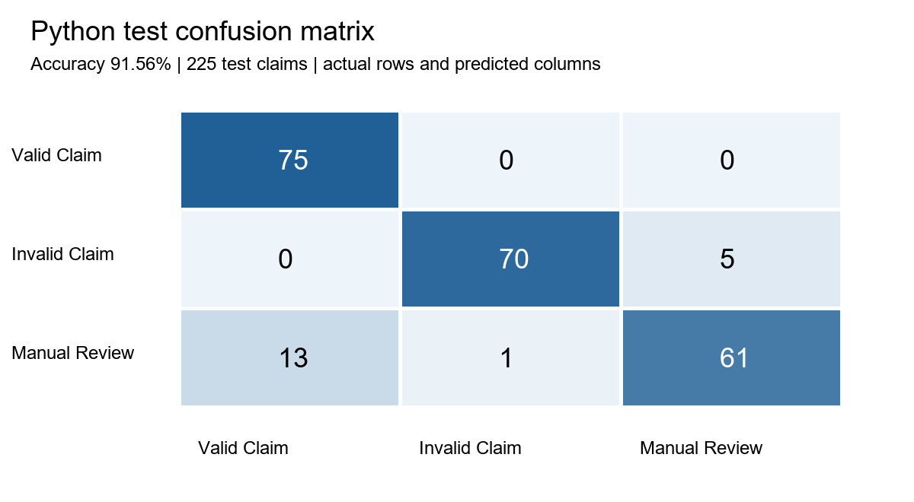
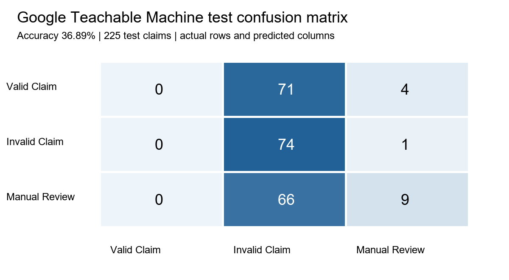

# AssureX Claim Engine Project Report

## Purpose of the document

This report presents AssureX Claim Engine for Aptech Techwiz evaluators. It explains the final merged application, its data and independent models, the warranty policies, and the recorded verification results against SRS version 1.0 section 1.10. The report accompanies the runnable local submission and synthetic judging data.

The Python model achieved 91.56% and the Teachable Machine model achieved 36.89% on the supplied 225-record test corpus. These are fresh agent-run measurements using the release inference code. Original training provenance is not independently established. The SRS requires at least 85% accuracy for each model.

## Problem definition

A warranty decision requires connecting a customer, product, purchase, covered fault, warranty period and supporting documents. Reviewers must identify inconsistent dates, mismatched serial numbers, unauthorized repairs and possible duplicate submissions. Disconnected evidence and inconsistent checks can cause delays or unsupported decisions. AssureX organizes that evidence and combines independent learned predictions with explicit policy checks.

## Background and business necessity

Customers need to find warranties, prepare evidence and understand claim progress. Service centers need repair histories and a repeatable intake process. Reviewers need original evidence, understandable recommendations and an information-request workflow. Administrators need configurable policies and a record of significant actions. A shared application supports those needs without claiming any measured cost saving or fraud reduction that the project has not demonstrated.

## Proposed solution

FastAPI coordinates HTML/Jinja interfaces, SQLite persistence, document extraction, a tabular Python classifier, a separate Google Teachable Machine classifier and a JSON policy engine. Preprocessed claim facts produce both structured model features and a visual Claim Summary Card. The card must exclude the Python prediction, confidence and final decision. A comparison stage measures class agreement and the absolute top-confidence difference. Fusion considers those results alongside missing evidence, contradictions, duplicate indicators and rule results. Authorized reviewer decisions retain the original AI evaluation.

## Scope

The project covers product/warranty information, evidence storage, claim intake, OCR verification, preprocessing, independent inference, policy checks, manual review, status tracking, reports and audit records. Manufacturer-system integration, payment settlement and live enterprise warranty databases are outside the SRS scope. Public hosting may be replaced only by the SRS-permitted complete local installation and working demonstration alternative.

## Assumptions

The supplied records are synthetic scenarios, not independently adjudicated real customer claims. Claim ID joins CSV records and cards. The original supplied train/validation/test corpus is the audit reference until the team supplies another complete matched version. Both models must use representations of the same underlying training claims. Extracted document fields may be wrong and therefore require verification. Public registration must not grant administrator or reviewer authority.

## Constraints

The verified release uses Python 3.11 and TensorFlow 2.15.1 so the exported Keras H5 model can execute in the same runtime as the web application. Copied machine-specific virtual environments are not distributable. Dataset and model training provenance, GTM training screenshots and independent student sign-off remain evidence requirements. The application has been exercised locally; production uptime and concurrency have not been established.

## Functional requirements

The release includes role-based login and profiles; product registration and extended-warranty fields; warranty views and alerts; document upload, extraction and verification; repair records; claim drafts, submission and CSV import; dual-model dossiers; policy evaluation; reviewer dispositions; audit logs; admin analytics; and PDF, print and data exports. Automated and workflow evidence accompany the implementation.

The functional requirement register and release review distinguish implemented behavior from remaining gaps such as comprehensive cross-document contradiction checks and historical policy/model version tracking. A route existing does not establish every acceptance condition.

## Non functional requirements

SRS acceptance targets are full claim processing within five seconds, storage for at least 10,000 claims with concurrent users, responsive desktop/tablet/mobile use, at least 85% unseen accuracy for both classifiers and 99% business-hours uptime. Local workflow timings and model results are recorded in the test evidence. A warm local request does not establish sustained load capacity or deployed availability. These broader acceptance claims remain unverified.

## Application architecture

The presentation layer collects authenticated input. Routes coordinate validation and persistence. Document processing extracts fields and hashes files. Feature computation supplies both independent model representations. Comparison and fusion combine probabilities with policy/evidence signals. SQLite preserves the dossier and subsequent reviewer action. No external generative-AI API was introduced into final decisions.

## Module descriptions

| Source module | Responsibility |
|---|---|
| web/app.py and web/helpers.py | Routes, sessions, permissions, workflow orchestration, scoped queries and validation |
| db/database.py | ORM entities, schema initialization and synthetic evaluator accounts |
| ocr/parser.py | Embedded PDF text, OCR fallback and SHA-256 hashes |
| decision/derived_features.py | Product age, remaining coverage, reporting delay and evidence/serial fields |
| models/tabular_model.py and tabular_model_v2.py | Probability inference and candidate benchmarking |
| models/image_classifier.py | H5 loading, normalization, label mapping and independent visual inference |
| rule_engine/evaluator.py | Category policies and registered condition handlers |
| decision/comparison.py and fusion.py | Consistency thresholds, final routing and explanations |
| dataset_generator/ | Scenario generation, record splits and card rendering |

## Database design

SQLite stores six ORM entities: User, Product, Claim, Document, Repair and AuditLog. Users own products, claims and evidence; products connect warranty information and repair history. Claims preserve original model probabilities, comparison, policy explanations and a separate reviewer disposition. Documents retain ownership, hashes and extraction verification metadata. The included database contains only synthetic evaluator data. The release seed preserves existing claims and refuses to overwrite them. Tests use a separate database through ASSUREX_DB_PATH.

## Data dictionary

The Common Dataset deliverable contains DATA_DICTIONARY.md and the supplied structured/data_dictionary.json. These define identifiers, product/purchase fields, warranty dates, fault/damage information, evidence flags, serial status, repair counts, derived intervals and actual_class. The database dictionary describes persistence separately from model features. IDs and actual_class are not tabular model inputs. Card styling must not intentionally encode the target label.

## Data Flow Diagram

The form and vault provide raw inputs; extraction verification provides corrected facts; preprocessing feeds both model paths. Policy files and historical records supply rule and duplicate signals. The dossier is stored and served through authorized pages and reports. The training corpus must never become a lookup table for predetermined application answers.

## Use Case Diagram

Customers manage products/evidence and submit claims. Service-center employees record repairs and submit permitted claims. Reviewers inspect dossiers, request information and record decisions. Administrators manage policies, analytics and audit records. Final evidence must demonstrate working flows, not merely navigation labels.

## Activity Diagram

Select a product, attach documents, verify extraction and inspect preparation warnings. Submission computes features, renders a card, runs models and checks policies. Conflicting evidence routes to review; unavailable required models block submission with a readiness error. A stored result can later receive an authorized reviewer disposition, audit entry and required notification.

## Sequence Diagram

The browser submits to an authenticated route. The route checks access, prepares facts, requests independent predictions, invokes comparison and rules, saves the dossier, then redirects to the result. A reviewer override adds a later decision without rewriting original model probabilities.

## Decision Flow Diagram

Adverse rules, incomplete evidence, duplicates, contradictions, low confidence, disagreement or excessive confidence difference require review. With no review trigger, aligned valid predictions support Likely Valid; aligned invalid predictions support Likely Invalid. Dataset class Invalid Claim is distinct from mandatory application review when a failed rule needs an authorized disposition.

## Rule engine design

Three JSON policy files describe electronics, appliances and automotive coverage. Configurable values include duration, grace, reporting deadlines, covered faults, exclusions, required documents and hard-fail/warning/review rule lists. Registered handlers return triggered/pass descriptions; the dossier retains the outcomes. Policy changes do not imply model retraining. Deliverable 7 provides a completeness matrix and separate proposed fields for warranty-start, repair and replacement conditions; the implementation team must confirm and enforce these before release.

## Python classification model design

Seven numerical features describe price, duration, repairs, missing documents, product age, remaining warranty and reporting delay. Five categorical features describe category, brand, fault, damage and serial status. Seven binary features describe unauthorized repairs, four evidence flags, contradiction and duplication. StandardScaler transforms numbers; OneHotEncoder handles categories including unknown values; binary values pass through. Models expose all three probabilities. The evaluation manifest preserves artifact hashes; current live dossiers retain a model-version label.

## Google Teachable Machine model design

The H5 classifier maps output indices using labels.txt. Live inference converts the card to RGB, resizes it to 224 by 224 and normalizes pixels as image/127.5 minus one. It receives no Python probabilities or final decision. Missing TensorFlow or failed model loading is reported as unavailable; fixed fallback probabilities have been removed. The health endpoint reports Python and GTM readiness separately. Authentic GTM project screenshots, settings and retraining history still need to be supplied by the students.

## Dataset description

The original corpus contains 1,500 unique claims, 500 per class. Training/validation/testing contain 1,050/225/225 records, with 350/75/75 examples per class. Two training variants produce 2,100 images; validation and test each contain 225 cards. Original CSV IDs do not overlap splits and all original image mappings match. The incompatible v2 image set is not packaged as matching evidence. The packaged dataset is the supplied original corpus. Original training provenance remains pending student evidence.

## Dataset generation method

Category-specific scenario generators create products, purchases, faults, damage, evidence and repair conditions. Scenario definitions include normal, expired, excluded, unauthorized-repair, missing-evidence, contradictory, duplicate, serial and boundary cases. Freeze record-level splits before card generation. Keep every variant of one claim in its split. Compare regenerated output against frozen files; a fixed seed is not proof that changed scripts produce identical records. Record the actual run in pending team evidence (dataset generation log). Independent label/content review is pending team evidence (dataset content review).

## Data preprocessing and feature engineering

Dates produce age, remaining coverage and reporting delay. The baseline uses fixed 30-day warranty months; final calendar semantics must be explicit. Evidence flags must reflect attached documents rather than optimistic defaults. Serial status remains unverified without evidence. Repair history and contradiction/duplicate flags must stay inspectable. The final missing-value contract is pending team evidence (missing value policy). Avoid silently inventing favorable dates or prices.

## Python model training procedure

Freeze the corpus, verify IDs, split by claim, fit preprocessing on training data, compare at least three algorithms, choose the model using validation, evaluate the frozen winner on test data and save all artifacts/metrics. Fit preprocessing inside cross-validation folds for leakage-resistant estimates; the supplied v2 script instead transforms the full training partition before cross-validation and this limitation must be addressed.

The supplied v2 candidates are RandomForest with 120 trees, depth 9, minimum split 6 and leaf 3; LogisticRegression with C 0.8 and 1,000 iterations; and XGBoost with 90 trees, depth 4, learning rate 0.07, subsample and column sample 0.85. Seed 42 is used. Deliverable 4 retains historical CV/validation results separately from current measurements. Actual training records and per-algorithm training scores remain pending team evidence (python training record) and pending team evidence (training scores).

## Google Teachable Machine training procedure

Create the three exact classes and upload only the matched training cards, normally 700 images per class. Keep 225 validation and 225 testing images out of training. Record settings, class counts, observations and screenshots. Use validation to choose revisions; log retraining; freeze the candidate before test evaluation. Export H5 and labels together and hash them. Never move failed test cases into training while retaining an unseen-test claim. Deliverable 5 supplies actual samples/results and clearly marked fields for project screenshots and training history.

## Model evaluation

The Python model achieved 91.56% and the Teachable Machine model achieved 36.89% on the supplied 225-record test corpus. These are fresh agent-run measurements using the release inference code. Original training provenance is not independently established. The SRS requires at least 85% accuracy for each model.

The artifact files match the team-supplied exports. evaluate_release.py records every test probability, confusion matrix, class metric and SHA-256 hash. The original corpus is the matched CSV/card reference. Historical v2 training results remain historical and are not substituted for the current evaluation. The first 30 supplied test cases form the paired comparison report. A separate live-renderer check records predictions on cards regenerated with the application renderer.

## Confusion matrix

Rows are actual classes; columns are predicted classes, ordered Valid Claim, Invalid Claim, Manual Review.

## Accuracy precision recall and F1 score

Precision measures correctness within a predicted class; recall measures recovery of an actual class; F1 is their harmonic mean. The following results use 75 examples per class.

### Python

Accuracy: 91.56%.

| Class | Precision | Recall | F1 | Support |
|---|---:|---:|---:|---:|
| Valid Claim | 0.852 | 1.000 | 0.920 | 75 |
| Invalid Claim | 0.986 | 0.933 | 0.959 | 75 |
| Manual Review | 0.924 | 0.813 | 0.865 | 75 |

### Google Teachable Machine

Accuracy: 36.89%.

| Class | Precision | Recall | F1 | Support |
|---|---:|---:|---:|---:|
| Valid Claim | 0.000 | 0.000 | 0.000 | 75 |
| Invalid Claim | 0.351 | 0.987 | 0.517 | 75 |
| Manual Review | 0.643 | 0.120 | 0.202 | 75 |

## Model prediction and confidence comparison

Calculate abs(Python top-class confidence minus GTM top-class confidence), independently of class agreement. Baseline YAML thresholds are 0.60 minimum confidence, 0.10 strong-match gap and 0.25 acceptable gap. Low confidence produces Uncertain Result; differing confident classes produce Model Disagreement; matching classes are Strong, Acceptable or Weak Match according to the gap. Test exact boundaries against the release configuration.

Deliverable 6 includes 30 actual paired cases with records/cards, all six probabilities, class match, gap, consistency, policy outcome, missing evidence, contradictions, duplicates and final explanation. Per-case disagreements are measured outcomes; no unsupported causal explanation is invented. Offline model evidence does not establish live dual-model integration.

## Testing strategy

The release regression run reported: 35 passed, 12 warnings in 76.69s (0:01:16). Detailed logs and workflow checks are stored in deliverable 08. Tests cover authentication, role restrictions, document actions, PDF extraction, reporting, thresholds, derived features, rules and fusion. Controlled model values in routing tests are clearly distinguished from the 225 real model predictions.

The eleven mandatory scenarios are provided as reproducible routing fixtures and a judging guide. Synthetic database dossiers use real inference outputs. Team members still need to execute and sign their independent review. A passing smoke test does not establish absence of all defects or compliance with load and uptime targets.

## Security considerations

Passwords use salted PBKDF2 with verification support for legacy SHA-256 hashes. Uploaded documents and summary cards require authentication and ownership checks. Public registration cannot create administrator or reviewer accounts. Reviewer actions require an allowed status and nonblank comments, preserve the original machine decision, and write an audit entry. Test data and the demo database contain no real customer evidence. Before public deployment, set a private SECRET_KEY, enable HTTPS, configure request limits and throttling, and replace demo credentials. Full security and dependency audits remain outside the local smoke-check evidence.

## Privacy considerations

The submission contains synthetic records and clearly marked demo evidence. Ownership checks apply to downloads and customer dossiers. Hashes detect identical bytes but do not prove authenticity or anonymization. The team must define retention and deletion rules and a responsible contact before accepting real customer information. Recovery copies remain outside the distributable package.

## Limitations

The Python model achieved 91.56% and the Teachable Machine model achieved 36.89% on the supplied 225-record test corpus. These are fresh agent-run measurements using the release inference code. Original training provenance is not independently established. The SRS requires at least 85% accuracy for each model.

The supplied corpus does not prove generalization to real claims or original training/test isolation. Authentic GTM training records and independent team verification are incomplete. The baseline uses fixed 30-day warranty months; absent OCR serial values can still fall back to entered values. Complete multi-document contradiction analysis, policy-version snapshots, independent load/usability checks and deployed uptime remain acceptance gaps. Video and deployment are intentionally reserved for the team. The HTML article is prepared locally and still needs public publication.

## Future enhancements

After baseline acceptance, consider improved extraction, probability calibration, drift monitoring, explicit warranty contracts, calendar-aware policies, tested duplicate similarity, accessibility and measured operational analytics. Each extension needs an acceptance test and should remain separate from required competition features. Historical claims must remain tied to the model/policy context used when evaluated.

## References and sign off

Authority: AssureX Claim Engine NextWave AI and ML SRS version 1.0, section 1.10. A copy is included in deliverable 16.

Team repository: https://github.com/Musab-Al-Mustafa/Techwiz

Technical blog: https://assurexclaimengine.blogspot.com/2026/09/building-assurex-claim-engine.html

Demonstration MP4: 13 Demonstration Video/demo_video.mp4 (Included in deliverable 13). Deployment URL: team to add. Proposed equal responsibility and actual verification records: 15 AI Usage Declaration. Verification signed off 24-29 September 2026.

