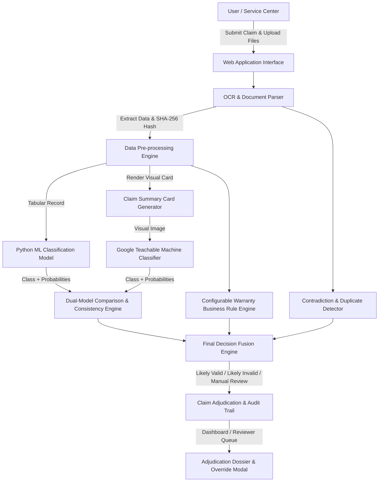

# AssureX Claim Engine - AI-Powered Warranty Adjudication Platform

> **Project Name:** AssureX Claim Engine  
> **Theme:** AI-Powered Document Ops  
> **Category:** NextWave AI and ML  
> **Version:** 1.0.0  

---

## 🚀 Overview

**AssureX Claim Engine** is an enterprise-grade AI-powered warranty claim validation and adjudication platform. It automates complex claim processing for manufacturers and service centers by combining:
1. **Python Tabular Machine Learning** (XGBoost / Random Forest / LightGBM)
2. **Computer Vision Claim Summary Card Classifier** (Google Teachable Machine - Keras/TensorFlow)
3. **Configurable Warranty Business Rule Engine** (JSON category policies)
4. **Document OCR & SHA-256 Hashing Engine** (EasyOCR / Tesseract / Hash Security)
5. **Dual-Model Comparison & Decision Fusion Engine**

Claims are classified into three distinct categories:
- 🟢 **Likely Valid** (Auto-Approval Candidate)
- 🔴 **Likely Invalid** (Auto-Rejection Candidate)
- 🟡 **Manual Review Required** (Flagged for Reviewer Queue)

---

## 🏗️ System Architecture



---

## 🛠️ Technology Stack & Dependencies

- **Web Frameworks:** FastAPI + Jinja2 server-rendered UI (original) and Django 5.2 + django-ninja REST API (`backend/`)
- **Backend & Database:** Python 3.11+, SQLAlchemy ORM, SQLite (`database/assurex.db`), Uvicorn
- **Machine Learning & Vision:** Scikit-Learn, TensorFlow, Keras, Joblib, Pandas, NumPy, Pillow (PIL)
- **Document Processing:** EasyOCR / Tesseract, Regex, SHA-256 Hash Engine

---

## 🔌 REST API (Django Ninja)

A complete REST API now lives alongside the original web application. It is
additive: both apps share the same SQLAlchemy models, SQLite database,
`uploads/` directory, warranty policies and ML models, so switching between
them never requires a data migration.

```bash
# Start the REST API (default: http://127.0.0.1:8011)
uv run python backend/manage.py runserver 8011

# or on Windows
run_api.bat
```

- **Swagger UI:** `http://127.0.0.1:8011/api/docs`
- **OpenAPI schema:** `http://127.0.0.1:8011/api/openapi.json`
- **Health probe:** `http://127.0.0.1:8011/api/v1/health`
- **Login:** `POST /api/v1/auth/login` → send the token as `Authorization: Bearer <token>`

Full endpoint reference, environment variables and the FastAPI → REST route
mapping are in [`documentation/REST_API.md`](documentation/REST_API.md).

---

## 🖥️ React Frontend (`frontend/`)

A complete single-page frontend consumes the REST API and implements the full
workflow — login/registration, dashboard, products & warranties, evidence
vault, 4-step claim intake wizard, claim dossier with dual-model comparison,
reviewer queue, warranty alerts, repairs and the admin console (analytics,
policies, audit log, settings).

```bash
cd frontend
npm install
npm run dev        # http://127.0.0.1:5173 (proxies /api to :8011)
```

- **Stack:** React 19, Vite 8, Tailwind CSS v4, React Router 7, Zustand, Axios
- **Design:** light iWarranty-inspired system — DM Serif Display + DM Sans, deep green `#035948` on warm white `#FAFAF8`
- **Tests:** `npm test` (24 unit/contract tests) and `npm run e2e` (21 browser checks)
- **Docs:** [`frontend/README.md`](frontend/README.md) and [`frontend/DESIGN_TOKENS.md`](frontend/DESIGN_TOKENS.md)

---

## ⚡ One-Click Execution (Windows)
Double-click `run_app.bat` in this directory (or project root). It will automatically set thread safety flags, launch the Uvicorn web server, and open `http://127.0.0.1:8000` in your default browser.

---

## 💻 Manual Setup & Execution Guide

### 1. Prerequisites
Ensure Python 3.11+ is installed on your system.

### 2. Setup Environment
```bash
# Clone the repository
git clone https://github.com/Musab-Al-Mustafa/Techwiz.git
cd Techwiz

# Activate virtual environment
.venv\Scripts\activate   # Windows
# source .venv/bin/activate # Linux/Mac

# Install dependencies
pip install -r requirements.txt
```

### 3. Initialize Database & Seed Data
```bash
python src/assurex_claim_engine/db/database.py
```

### 4. Generate Synthetic Dataset & Visual Claim Summary Cards
```bash
# Generates 1,500 structured claims (500 Valid, 500 Invalid, 500 Manual Review)
python dataset_generator/generate_dataset.py

# Renders 2,550 visual Claim Summary Card images (including 2+ training variations)
python dataset_generator/generate_summary_cards.py
```

### 5. Train Tabular ML & Vision Classifier Models
```bash
# Train & benchmark Random Forest, XGBoost, LightGBM
python src/assurex_claim_engine/models/tabular_model.py

# Vision Model is trained on Google Teachable Machine website and exported as Keras .h5
# (Files placed in GTM Models/ directory)
```

### 6. Run Web Application Server
```bash
python -m uvicorn src.assurex_claim_engine.web.app:app --host 127.0.0.1 --port 8000 --reload
```
Open your browser and navigate to: **`http://127.0.0.1:8000`**

---

## 🔑 Evaluator & Admin Login Credentials

| Role | Username / Email | Password | Access Rights |
| :--- | :--- | :--- | :--- |
| **Customer** | `customer@assurex.com` | `customer123` | Claim Intake, Product & Warranty Status |
| **Service Center** | `service@assurex.com` | `service123` | Claim Intake & OCR Data Verification |
| **Reviewer** | `reviewer@assurex.com` | `reviewer123` | Manual Review Queue & Decision Override |
| **Admin** | `admin@assurex.com` | `admin123` | Full System Analytics & Downloadable Reports |

---

## 🧪 Automated Testing & Verification

Run the full pytest suite covering all **11 mandatory SRS scenarios**:
```bash
pytest tests/
```

Run the REST API suite (isolated temporary database and uploads directory):
```bash
uv run pytest tests_api -q
```

### Mandatory Scenario Coverage Checklist
- [x] **Scenario 1:** Valid Claim (Passed rules, high dual-model confidence)
- [x] **Scenario 2:** Invalid Claim (Excluded damage / liquid spill)
- [x] **Scenario 3:** Manual Review (Borderline features / missing receipt)
- [x] **Scenario 4:** Expired Warranty (Claim submission past warranty end date)
- [x] **Scenario 5:** Missing Document Alert (Receipt or serial photo missing)
- [x] **Scenario 6:** Duplicate Claim Detection (Matching document hash or serial)
- [x] **Scenario 7:** Contradictory Timeline (Fault date prior to purchase date)
- [x] **Scenario 8:** Serial Number Mismatch (User serial vs OCR extracted serial)
- [x] **Scenario 9:** Unauthorized Repair (Previous repair by unauthorized center)
- [x] **Scenario 10:** Tricky Boundary Date (Claim filed on exact last day of coverage)
- [x] **Scenario 11:** Model Disagreement (Python ML vs Vision model conflict)

---

## 📊 Deliverables & Reports

- 📄 **Requirements Breakdown & Roadmap:** [`PROJECT_REQUIREMENTS_AND_ROADMAP.md`](PROJECT_REQUIREMENTS_AND_ROADMAP.md)
- 📈 **30-Claim Model Comparison Report:** [`reports/model_comparison_report.md`](reports/model_comparison_report.md)
- 📝 **AI Tool Usage Declaration:** [`AI_USAGE.md`](AI_USAGE.md)

---
*AssureX Claim Engine v1.0.0 - Built for Aptech Technical Evaluation.*
