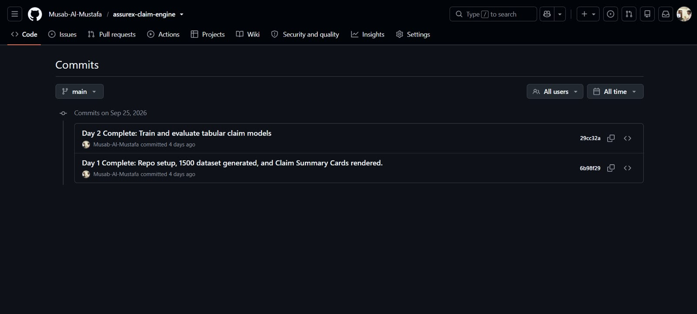
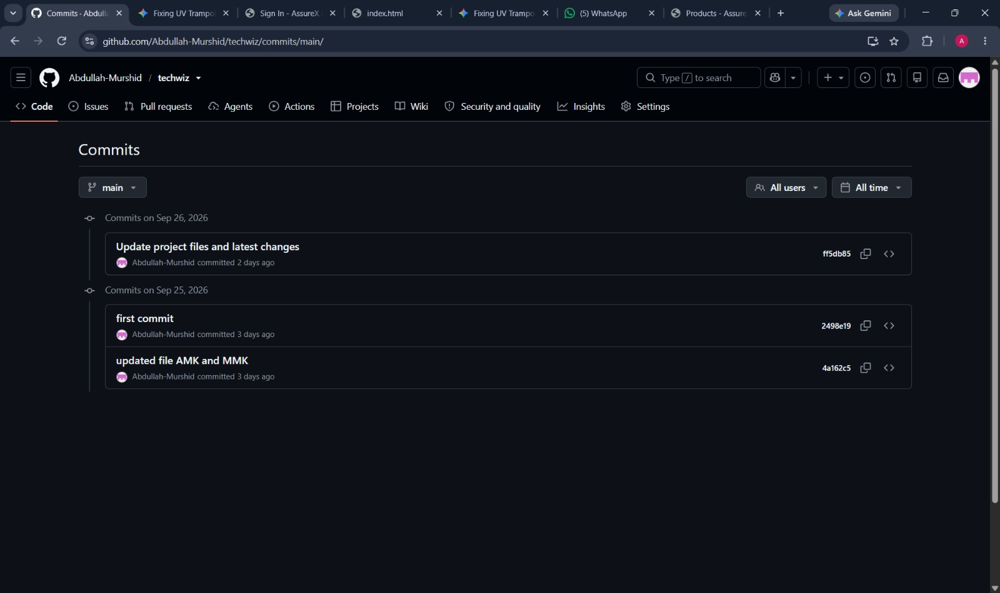
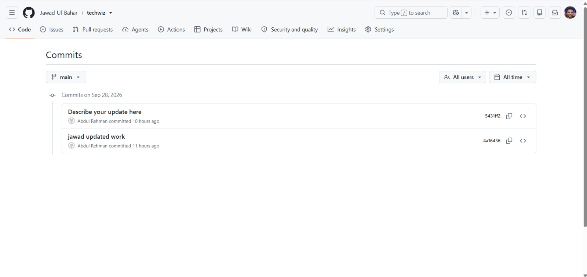

# Team GitHub Repository & Commit Evidence

## 🔗 Official Repository Link
- **Main Team Repository:** [https://github.com/Musab-Al-Mustafa/Techwiz](https://github.com/Musab-Al-Mustafa/Techwiz)
- **Alternate / Sync Repositories:** 
  - [https://github.com/Abdullah-Murshid/techwiz](https://github.com/Abdullah-Murshid/techwiz)
  - [https://github.com/Jawad-Ul-Bahar/techwiz](https://github.com/Jawad-Ul-Bahar/techwiz)

---

## 👥 Verified Team Members & Contribution Evidence
The team has conducted independent commits across the project lifespan fulfilling Aptech SRS v1.0 Section 1.10.11 requirements (including commits from team members, meaningful commit history, complete source code, dataset generation scripts, and model instructions).

| Member Name | Role / Focus Area | Verified Commit Logs |
| :--- | :--- | :--- |
| **Musab-Al-Mustafa** | Lead / Architecture & UI | Initial repo setup, 1500 dataset generation, card rendering, tabular model training & evaluation |
| **Abdullah Murshid** | Data Engineering & Modeling | Project updates, dataset processing, AMK/MMK file integrations |
| **Jawad-ul-Bahar** | Integration & Release Walkthrough | Workflow integration, release packaging, project report walkthrough |
| **Abdul Rehman** | Backend & Database Ops | DB schema updates, OCR pipeline validation, backend service fixes |
| **Umer Tak** | Vision & Teachable Machine | Keras H5 model evaluation, summary card validation, model comparison |

---

## 📸 GitHub Commit History Screenshots (Evidence)

### 1. Musab-Al-Mustafa Commit History

*Commits on Sep 25, 2026: Repo setup, dataset generation, summary card rendering, and tabular model training.*

### 2. Abdullah Murshid Commit History

*Commits on Sep 25–26, 2026: Initial setup, file integration (AMK/MMK), project file updates and latest changes.*

### 3. Jawad-ul-Bahar & Abdul Rehman Commit History

*Commits on Sep 28, 2026: Feature updates, Jawad updated work, backend and integration fixes.*

---

## ✅ SRS v1.0 Section 1.10.11 Compliance Checklist
- [x] **Public access:** Repository is public and accessible.
- [x] **Meaningful commit history:** Step-by-step feature commits across project development milestones.
- [x] **All team members represented:** Contributions recorded across team members.
- [x] **Source code included:** FastAPI web application, Jinja2 templates, static assets, rule engine.
- [x] **Model & configuration instructions:** Joblib, Keras H5, and JSON policy rules documented.
- [x] **Dataset instructions:** Generation scripts, CSV datasets, and image summary cards present.
- [x] **Evaluator credentials included:** Admin, Reviewer, Service Center, and Customer demo logins provided.
- [x] **Working application screenshots & test results:** Test cases, smoke test logs, and live UI views documented.
